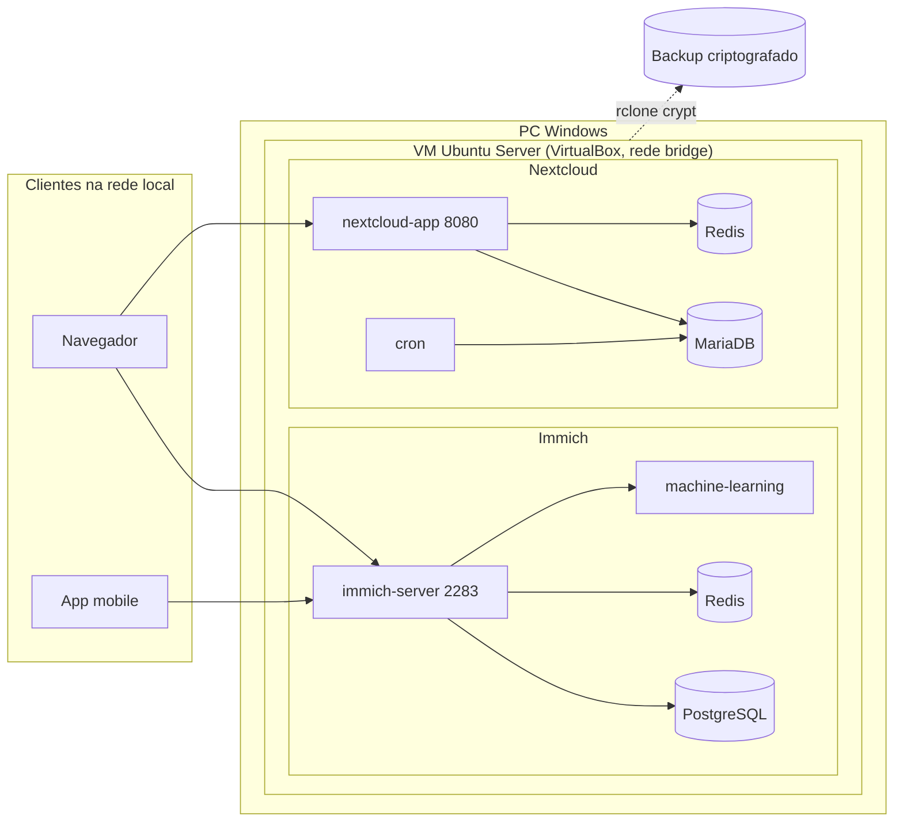

# Homelab self-hosted: Immich e Nextcloud com Docker

Servidor pessoal para substituir o armazenamento pago do Google (Fotos e Drive) no uso familiar. O **Immich** guarda fotos e vídeos e o **Nextcloud** guarda documentos. Os dois rodam em Docker dentro de uma VM com Ubuntu Server.

> Projeto pessoal e educacional, sem relação oficial com os projetos Immich, Nextcloud ou rclone.

## Objetivo

- Hospedar os próprios dados em casa, sem mensalidade de nuvem.
- Separar fotos e vídeos (Immich) de documentos e arquivos (Nextcloud).
- Praticar administração de servidores Linux, Docker, bancos de dados e backup.

## Arquitetura



## Tecnologias

- Ubuntu Server 26.04 LTS em VM no VirtualBox (4 vCPUs, 6 GB de RAM, disco virtual de 400 GB, rede em modo bridge)
- Docker Engine e Docker Compose (instalados pelo repositório oficial da Docker)
- Immich (com PostgreSQL, Redis/Valkey e aprendizado de máquina)
- Nextcloud (com MariaDB, Redis e contêiner de cron)
- rclone, com `crypt`, para backup criptografado fora da VM
- SSH para administração remota

## Estrutura do repositório

```
.
├── immich/
│   ├── docker-compose.yml
│   └── .env.example
├── nextcloud/
│   ├── docker-compose.yml
│   └── .env.example
├── .gitignore
└── README.md
```

O `docker-compose.yml` do Immich é baseado no arquivo oficial publicado nas versões do projeto. Os arquivos `.env` reais **não** estão no repositório: apenas os modelos `.env.example`, sem senhas.

## Como subir

### Pré-requisitos

- Ubuntu Server (físico ou em VM) com Docker Engine e o plugin Compose instalados pelo repositório oficial da Docker. Evite o pacote `docker.io` da distribuição.
- Recomendado: 4 vCPUs e pelo menos 6 GB de RAM. Consulte a documentação do Immich para os requisitos atuais.

### Immich

```bash
cd immich
cp .env.example .env
# Edite o .env: defina DB_PASSWORD (apenas letras e números) e TZ
docker compose up -d
```

Acesso: `http://<IP_DA_VM>:2283`. O primeiro usuário cadastrado vira administrador.

### Nextcloud

```bash
cd nextcloud
cp .env.example .env
# Edite o .env: substitua os valores de exemplo (cambiar_esto) por senhas fortes
# Edite o docker-compose.yml: troque NEXTCLOUD_TRUSTED_DOMAINS pelo IP da sua VM
docker compose up -d
```

Acesso: `http://<IP_DA_VM>:8080`. O usuário administrador é o definido em `NC_USER` e `NC_PASS`.

Para gerar senhas aleatórias: `openssl rand -hex 16`.

## Decisões técnicas

- **Rede em modo bridge:** a VM recebe um IP da rede local, então celulares e outros computadores conseguem acessar os serviços (em NAT isso não funcionava).
- **Versões fixadas na versão maior:** o Immich usa `IMMICH_VERSION=v3` e o Nextcloud usa a tag `nextcloud:35`, para evitar saltos de versão maior inesperados em um `docker compose pull`.
- **Dados fora dos contêineres:** os dados ficam em pastas no disco da VM (bind mounts), e as imagens podem ser recriadas sem perder nada.
- **Instalação do Docker pelo repositório oficial:** a documentação do Immich desaconselha o pacote `docker.io` do Ubuntu.
- **Migração do Google Fotos/Drive:** cerca de 50 GB enviados com a CLI oficial do Immich, usando `--dry-run` antes do envio real. O Immich descarta duplicados comparando o hash dos arquivos.

## Operação

**Desligamento seguro:** parar os dois stacks antes de desligar a VM, para fechar os bancos de dados de forma limpa.

```bash
docker compose stop   # em cada pasta (immich e nextcloud)
sudo poweroff
```

**Atualizar o Immich:**

1. Ler as notas da versão e procurar a seção "Breaking Changes".
2. Gerar um dump do banco (Administração, Filas de trabalho, Criar dump do banco de dados).
3. `docker compose pull && docker compose up -d`
4. Conferir com `docker compose ps` que todos os contêineres estão `healthy`.
5. Limpar imagens antigas com `docker image prune`.

**Atualizar o Nextcloud:** parar os contêineres, copiar a pasta inteira como backup, trocar a tag da imagem para a próxima versão maior (uma por vez, sem pular) e rodar `docker compose pull && docker compose up -d`.

## Backup

- **Immich:** dump do PostgreSQL gerado pelo próprio Immich (fica em `library/backups`) mais a pasta `library` com os arquivos originais. A pasta `postgres` não deve ser copiada com o serviço rodando, porque a cópia pode ficar corrompida.
- **Nextcloud:** parar os contêineres e copiar a pasta (arquivos e banco), ou gerar um dump do MariaDB.
- **Fora da VM:** cópia com rclone usando `crypt`, que criptografa o conteúdo e os nomes dos arquivos. O arquivo `rclone.conf` (que guarda as chaves) fica fora do repositório e em local seguro.

## Problemas encontrados e aprendizados

- **VM sem acesso pela rede local:** o adaptador estava em NAT (IP 10.0.2.15). Trocar para bridge resolveu.
- **`permission denied` no socket do Docker:** após `usermod -aG docker`, é preciso abrir uma nova sessão para o grupo valer.
- **Lentidão intermitente:** a investigação com `uptime`, `free -h`, `docker stats` e `curl` (medindo tempo de resposta) descartou o servidor. A causa era um cabo de rede mal conectado.
- **Espaço "usado" no Immich:** o painel mostrava 48 GiB (arquivos originais) e 65 GiB (disco inteiro da VM, incluindo sistema, imagens do Docker, bancos e miniaturas). São duas medidas diferentes.

## Segurança

- Arquivos `.env` e `rclone.conf` fora do Git (`.gitignore`).
- Serviços acessíveis apenas na rede local. Nenhuma porta aberta no roteador.
- Senhas iniciais trocadas e únicas por serviço.
- Atenção: o acesso é por HTTP, sem TLS, o que é aceitável apenas dentro da rede local.

## Próximos passos

- [ ] Acesso remoto seguro com VPN (Tailscale) e HTTPS
- [ ] Verificação em duas etapas (TOTP) no Nextcloud
- [ ] Reserva de IP no roteador
- [ ] Testar a restauração do backup periodicamente
- [ ] Automatizar o backup com tarefa agendada

## Créditos

[Immich](https://immich.app), [Nextcloud](https://nextcloud.com), [rclone](https://rclone.org) e [Docker](https://www.docker.com).